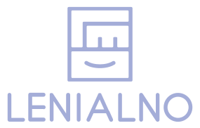

<p align="center"></p>

# Lenialno agent skills

The Lenialno catalog for Claude Code plugins. Add it once, then install product lines by name.

```bash
claude plugin marketplace add lenialno/skills
```

| Product line | What it is | Install |
|---|---|---|
| [Roofline](https://github.com/lenialno/roofline) | Inference Engineer skills for on-prem LLM serving on vLLM or SGLang: runtime, tool-call parsers, performance, SLO incidents, capacity, a Taskfile toolbox and an incident subagent. English and Russian versions | `claude plugin install roofline@lenialno` |

Updates: `claude plugin marketplace update lenialno`, then `claude plugin update <plugin>@lenialno`.

Each line is also installable as plain Agent Skills without Claude Code plugins: `npx skills add lenialno/roofline`.

## По-русски

Каталог плагинов Lenialno для Claude Code. Добавьте каталог один раз командой выше, затем ставьте линейки по имени: `claude plugin install roofline@lenialno`. Roofline: skills инженера инференса для on-prem vLLM и SGLang, на английском и русском.
